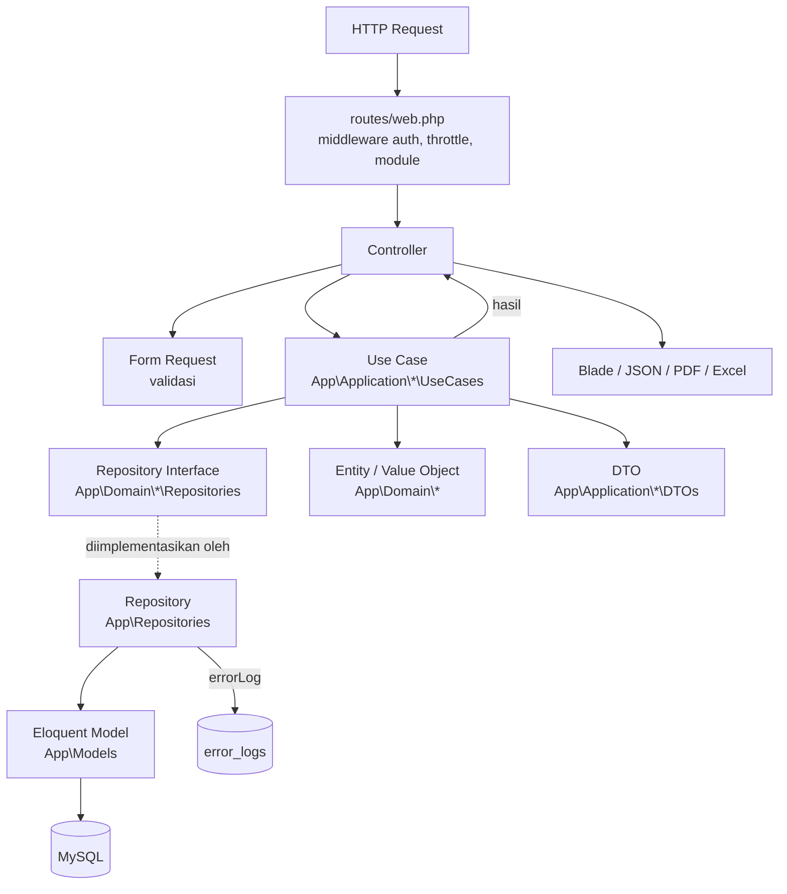

# POS & Inventory Management

Aplikasi Point of Sales (POS) dengan manajemen inventori, dibangun dengan Laravel 12. Nama aplikasi bawaan pada `.env.example` adalah `SMI Sembako` (dapat diubah melalui `APP_NAME` dan menu pengaturan aplikasi).

Aplikasi mencakup master data, pembelian, penjualan (kasir), retur penjualan, stok harian/bulanan, kas, dashboard, dan laporan operasional. Antarmuka berbahasa Indonesia (`APP_LOCALE=id`).

> **Status:** dalam pengembangan aktif. Lisensi proyek belum ditetapkan (lihat [Lisensi](#16-lisensi)).

## Daftar Isi

1. [Fitur Aplikasi](#1-fitur-aplikasi)
2. [Tech Stack](#2-tech-stack)
3. [Arsitektur Aplikasi](#3-arsitektur-aplikasi)
4. [Struktur Direktori](#4-struktur-direktori)
5. [Persyaratan Sistem](#5-persyaratan-sistem)
6. [Instalasi dan Setup Development](#6-instalasi-dan-setup-development)
7. [Konfigurasi Environment](#7-konfigurasi-environment)
8. [Menjalankan Aplikasi](#8-menjalankan-aplikasi)
9. [Testing](#9-testing)
10. [Panduan Pengembangan](#10-panduan-pengembangan)
11. [Keamanan](#11-keamanan)
12. [Deployment](#12-deployment)
13. [Batasan dan Hal yang Perlu Dikonfirmasi](#13-batasan-dan-hal-yang-perlu-dikonfirmasi)
14. [Perintah Berguna](#15-perintah-berguna)
15. [Lisensi](#16-lisensi)

---

## 1. Fitur Aplikasi

Status di bawah ditentukan dari keberadaan route, controller, use case, view, dan migration. Keberadaan fitur bukan jaminan bebas bug; hanya modul Kas dan Dashboard yang memiliki test otomatis (lihat [Testing](#9-testing)).

### Master Data (tersedia)

| Modul             | Route prefix         | Catatan                                                                                       |
| ----------------- | -------------------- | --------------------------------------------------------------------------------------------- |
| User              | `masters/users`      | CRUD                                                                                          |
| Role & permission | `masters/roles`      | Hak akses per menu (read/create/update/delete)                                                |
| Supplier          | `masters/suppliers`  | CRUD, export Excel                                                                            |
| Customer          | `masters/customers`  | CRUD, export Excel (customer memiliki persentase diskon)                                      |
| Kategori produk   | `masters/categories` | CRUD, import/export Excel                                                                     |
| Satuan produk     | `masters/units`      | CRUD, import/export Excel                                                                     |
| Produk            | `masters/products`   | CRUD, multi harga/satuan (`prices`), import/export Excel, import & reset diskon, import harga |

### Transaksi (tersedia)

- **Pembelian** (`transactions/purchases`): keranjang pembelian, penyimpanan pembelian, dan pembayaran bertahap (`payments`).
- **Penjualan** (`transactions/sales`): keranjang penjualan, harga/qty per item, penyimpanan transaksi, struk (`receipt`) dan PDF invoice (`pdf`). Nomor invoice berformat `INVyymm-00000`.
- **Retur penjualan** (`transactions/returns`): keranjang retur berbasis penjualan asal, ubah qty, dan penyelesaian retur.
- Penghapusan pembelian, penjualan, dan retur sengaja **tidak disediakan** agar data tetap konsisten.

### Inventori (tersedia)

- **Stok harian** (`stocks/daily`): import Excel, import pembaruan, aktivasi, hapus, detail, export, dan pembentukan stok bulanan.
- **Stok bulanan** (`stocks/monthly`): pembuatan, aktivasi, hapus, detail, dan export.
- Stok resmi produk disimpan pada `products.current_stock` dalam satuan dasar (`quantity × multiples_quantity`).

### Kas (tersedia)

- Dashboard kas (`cash/dashboard`), transaksi kas (`cash/transactions`) dengan nomor `CSHyymm-00001`, dan rekonsiliasi saldo bulanan (`cash/reconciliation`).

### Dashboard (tersedia)

- Ringkasan penjualan (hari ini/bulan/tahun), grafik penjualan bulanan (Chart.js), stok menipis, serta produk fast/slow moving.

### Laporan (tersedia)

Laporan pembelian, penjualan, retur penjualan, stok, dan kas (`reports/*`) dengan filter tanggal, ringkasan, serta export Excel dan PDF.

### Autentikasi, role, dan pengaturan (tersedia)

- Login/logout, pembatasan akses menu melalui middleware `module`, dan pengaturan aplikasi (nama, alamat, logo toko) pada `settings/applications`.
- Log aktivitas (`activity_logs`) dan log error (`error_logs`) tersimpan di database.

---

## 2. Tech Stack

Versi diambil dari `composer.json`, `composer.lock`, `package.json`, dan lingkungan lokal.

### Backend

| Komponen                                    | Versi                                                |
| ------------------------------------------- | ---------------------------------------------------- |
| PHP                                         | `^8.2` pada `composer.json`; dikembangkan dengan 8.3 |
| Laravel Framework                           | 12.x (terpasang v12.69.3)                            |
| `maatwebsite/excel`                         | `^4.0` (terpasang 4.0.3)                             |
| `yajra/laravel-datatables-oracle`           | `^12.0`                                              |
| `barryvdh/laravel-dompdf` / `dompdf/dompdf` | `^3.1` (terpasang v3.1.2)                            |
| `picqer/php-barcode-generator`              | `^3.3`                                               |
| Laravel Pint                                | `^1.24` (config: `pint.json`)                        |
| PHPUnit                                     | `^11.5.50`                                           |

### Database

- MySQL 8.0 (lokal terverifikasi 8.0.46). Koneksi default bernama `pos` (`DB_CONNECTION=pos`).

### Frontend

- Laravel Blade dengan komponen di `resources/views/components` (`x-form-input`, `x-form-select`, `x-button`, `x-modal`, dll.).
- Bootstrap 5, jQuery 4.0.0, DataTables, Bootbox, dan Chart.js 4.x. Aset ini **dibundel di `public/assets`** (`vendor/`, `js/theme.bundle.js`, `js/vendor.bundle.js`, `js/app.js`), bukan dipasang lewat npm. Versi persis DataTables dan Bootbox perlu dikonfirmasi dari file bundel.

### Build tools

- Vite `^7.0.7` dengan `laravel-vite-plugin` `^2.0.0` (input: `resources/css/app.css`).
- Paket npm: `@fontsource-variable/inter`, `material-symbols`.

### Infrastruktur

- Nginx + PHP-FPM direncanakan/diasumsikan; **tidak ada file konfigurasi server di repository**.
- Session, cache, dan queue memakai driver `database`.

---

## 3. Arsitektur Aplikasi

Aplikasi memadukan MVC Laravel, Domain-Driven Design ringan, repository pattern, dan application layer berbasis use case (satu class per operasi, method `execute()`).

### Alur request



### Peran tiap lapisan

| Lapisan               | Lokasi                                        | Tanggung jawab                                                                        |
| --------------------- | --------------------------------------------- | ------------------------------------------------------------------------------------- |
| Route & middleware    | `routes/web.php`, `app/Http/Middleware`       | Auth, throttle, dan izin menu `module:<route>,<akses>` (`ModuleAccessMiddleware`)     |
| Controller            | `app/Http/Controllers`                        | Menerima request, memanggil use case, mengembalikan view/JSON/PDF/Excel               |
| Form Request          | `app/Http/Requests`                           | Validasi input; beberapa menyediakan `toFilter()` untuk laporan                       |
| Use Case              | `app/Application/<Modul>/UseCases`            | Satu operasi bisnis; mengatur transaksi DB (`DB::beginTransaction`/`DB::transaction`) |
| DTO                   | `app/Application/<Modul>/DTOs`                | Pembawa data antar lapisan (turunan `App\Base\DTO`)                                   |
| Entity & Value Object | `app/Domain/<Modul>/Entities`, `ValueObjects` | Representasi konsep domain (turunan `App\Base\Entity`), mis. `CustomerSaleValue`      |
| Repository Interface  | `app/Domain/<Modul>/Repositories`             | Kontrak akses data                                                                    |
| Repository            | `app/Repositories`                            | Implementasi Eloquent, konversi model ke entity, `errorLog()`                         |
| Model                 | `app/Models`                                  | Persistensi dan relasi                                                                |

### Dependency injection

`app/Providers/RepositoryServiceProvider.php` memakai **contextual binding**: array `$repositories` memetakan `Interface::class => [UseCase::class => Implementasi::class]`. Konsekuensinya, interface repository hanya dapat di-resolve di dalam use case yang terdaftar; use case baru **wajib didaftarkan** untuk setiap interface yang diinjeksikan (termasuk `ErrorLogRepositoryInterface` dan `ActivityLogRepositoryInterface`).

### Error handling dan logging

- Repository menangkap `\Throwable`, memanggil `errorLog(__METHOD__, $message)` dari `App\Base\Repository` (menyimpan ke tabel `error_logs`), lalu melempar ulang exception.
- Use case mencatat aktivitas melalui `ActivityLogRepositoryInterface` (tabel `activity_logs`).

### Catatan struktur

- Direktori `app/Application/Rreport` (ejaan dengan dua "r") berisi use case monitoring stok bulanan dan berdampingan dengan `app/Application/Report`. Ini kondisi aktual repository.

---

## 4. Struktur Direktori

```text
app/
├── Application/<Modul>/{UseCases,DTOs}   # Use case & DTO per modul (Cash, Dashboard, Sale, Purchase, Stock, ...)
├── Base/                                 # DTO, Entity, Repository (errorLog)
├── Domain/<Modul>/                       # Entities, ValueObjects, Enums, Repositories (interface)
├── Exports/  Imports/                    # Maatwebsite Excel (export/import per modul)
├── Http/
│   ├── Controllers/                      # Controller tipis
│   ├── Middleware/ModuleAccessMiddleware.php
│   └── Requests/<Modul>/                 # Form Request
├── Models/                               # Eloquent model
├── Providers/RepositoryServiceProvider.php
├── Repositories/                         # Implementasi repository
└── View/                                 # View component class
bootstrap/
├── app.php                               # Routing, alias middleware `module`
└── helpers.php                           # Helper global (setting, modules, logo, logo_data_uri, ...)
database/{migrations,seeders,factories}
public/assets/{js,vendor,images}          # Aset front-end yang dibundel
resources/{css,views/{components,pages}}  # Blade
routes/web.php
tests/{Feature,Unit}
build.sh  dev.sh  pint.sh                 # Skrip bantu (lihat bagian Deployment)
```

---

## 5. Persyaratan Sistem

- PHP ≥ 8.2 (disarankan 8.3) dengan ekstensi standar Laravel (`mbstring`, `openssl`, `pdo_mysql`, `tokenizer`, `xml`, `ctype`, `json`, `fileinfo`) serta `gd` (gambar pada PDF/Excel) dan `zip` (Excel). Daftar ini disimpulkan dari kebutuhan Laravel dan paket; belum diuji pada lingkungan bersih.
- Composer 2.
- MySQL 8.0.
- Node.js dan npm (untuk Vite; versi minimal mengikuti Vite 7, yaitu Node 20.19+ atau 22.12+).
- Web server Nginx + PHP-FPM untuk production (opsional untuk development; `php artisan serve` cukup).

---

## 6. Instalasi dan Setup Development

```bash
# 1. Clone repository (ganti dengan URL repository Anda)
git clone <url-repository> pos
cd pos

# 2. Instal dependensi PHP
composer install

# 3. Siapkan environment
cp .env.example .env
php artisan key:generate

# 4. Buat database MySQL (nama sesuai DB_DATABASE, default: pos), lalu isi
#    DB_USERNAME dan DB_PASSWORD pada .env

# 5. Migration dan seeder
php artisan migrate
php artisan db:seed

# 6. Aset frontend dan symlink storage (untuk logo toko)
npm install
npm run build
php artisan storage:link
```

Seeder (`DatabaseSeeder`) menjalankan: `RoleSeeder`, `ModuleSeeder`, `UserSeeder`, `SettingSeeder`, `SupplierSeeder`, `CustomerSeeder`, `CategorySeeder`, `UnitSeeder`, `ProductSeeder`. `UserSeeder` membuat akun awal (admin dan kasir) — lihat `database/seeders/UserSeeder.php` untuk kredensialnya dan **ganti passwordnya** sebelum dipakai di luar lingkungan lokal.

> `ModuleSeeder` bersifat idempoten (menambah/memperbarui menu tanpa menimpa hak akses yang sudah diubah). Jika menu baru (mis. "Laporan kas") belum muncul di database yang sudah berjalan, jalankan `php artisan db:seed --class=ModuleSeeder` setelah memeriksa dampaknya.

---

## 7. Konfigurasi Environment

Variabel penting pada `.env` (nilai default ada di `.env.example`; jangan commit `.env`):

| Kelompok        | Variabel                                                                               | Keterangan                                                                            |
| --------------- | -------------------------------------------------------------------------------------- | ------------------------------------------------------------------------------------- |
| Aplikasi        | `APP_NAME`, `APP_ENV`, `APP_DEBUG`, `APP_URL`, `APP_KEY`                               | `APP_KEY` dibuat oleh `key:generate`                                                  |
| Locale          | `APP_LOCALE=id`, `APP_FALLBACK_LOCALE=id`, `APP_FAKER_LOCALE=id_ID`                    |                                                                                       |
| Database        | `DB_CONNECTION=pos`, `DB_HOST`, `DB_PORT`, `DB_DATABASE`, `DB_USERNAME`, `DB_PASSWORD` | Koneksi `pos` didefinisikan di `config/database.php`; model dan test MySQL memakainya |
| Session & cache | `SESSION_DRIVER=database`, `SESSION_LIFETIME`, `CACHE_STORE=database`                  | Butuh tabel `sessions`/`cache` (dibuat migration)                                     |
| Queue           | `QUEUE_CONNECTION=database`                                                            | Butuh tabel `jobs`                                                                    |
| Log             | `LOG_CHANNEL`, `LOG_STACK`, `LOG_LEVEL`                                                |                                                                                       |
| PDF             | `LARAVEL_PDF_DRIVER=dompdf`                                                            |                                                                                       |
| Lainnya         | `FILESYSTEM_DISK=local`, `BCRYPT_ROUNDS`                                               | Logo toko disimpan pada disk `public` (`images/settings`)                             |

Mail, Redis, dan AWS pada `.env.example` dikomentari dan tidak dipakai oleh fitur yang ada.

---

## 8. Menjalankan Aplikasi

### Development

```bash
php artisan serve        # http://127.0.0.1:8000
npm run dev              # opsional, Vite dev server
composer dev             # menjalankan server, queue listener, pail, dan Vite sekaligus
```

`composer dev` memakai `npx concurrently` (paket sudah ada di `devDependencies`).

### Production

Gunakan `npm run build` (bukan `npm run dev`) dan lihat [Deployment](#12-deployment).

---

## 9. Testing

```bash
php artisan test
```

Konfigurasi:

- `phpunit.xml` memakai SQLite in-memory dan **mengecualikan** `tests/Feature/Cash` serta `tests/Feature/Dashboard`, karena model aplikasi memakai koneksi MySQL `pos` dan skema yang bergantung pada MySQL.
- `phpunit.mysql.xml` memakai koneksi MySQL `pos` dari `.env` untuk dua direktori tersebut (test dibungkus transaksi dan di-rollback). **Arahkan `.env` ke database pengembangan/uji, bukan production**:

```bash
php artisan test --configuration=phpunit.mysql.xml
php artisan test --configuration=phpunit.mysql.xml --filter=CashFeatureTest
```

Test yang ada: `tests/Feature/Cash/CashFeatureTest.php`, `tests/Feature/Dashboard/DashboardFeatureTest.php`, serta `ExampleTest` bawaan Laravel (Feature dan Unit). `tests/Feature/ExampleTest.php` diketahui gagal pada konfigurasi SQLite (pra-ada). Modul lain (penjualan, pembelian, retur, stok, laporan selain kas) **belum memiliki test otomatis**.

Pada test izin akses, helper `modules()` menyimpan cache statis per proses sehingga test terkait perlu `#[RunInSeparateProcess]`.

---

## 10. Panduan Pengembangan

Konvensi di bawah diterapkan pada kode yang ada dan diperkuat di [CLAUDE.md](CLAUDE.md).

- Berkas PHP memakai `declare(strict_types=1);`, tipe parameter/return eksplisit, **named arguments**, dan komentar singkat per langkah logika. Format kode dengan Pint (`pint.json`).
- Controller tipis: validasi lewat Form Request, lalu panggil use case. Operasi baca (tabel DataTables, laporan) tetap lewat use case (`Get*Table`, `Get*Summary`, `Get*Query`).
- Operasi yang mengubah banyak record dibungkus transaksi DB di use case.
- Akses data hanya lewat repository interface di `app/Domain/.../Repositories`; implementasi di `app/Repositories` mengikuti pola `try/catch` → `errorLog(__METHOD__, ...)` → rethrow.
- Izin menu memakai middleware `module:<nama.route>,<read|create|update|delete>` pada route; menu dan hak akses bersumber dari `ModuleSeeder`.
- Blade memakai komponen `x-form-input`, `x-form-select`, `x-button`, `x-modal`; input tanggal memakai atribut `data-flatpickr=""`. Modal memakai backdrop `static` dan `modal-dialog-scrollable`.
- Quantity dasar selalu `quantity × multiples_quantity`. Nilai uang pada kode Kas/Dashboard dihitung sebagai string desimal dengan bcmath.

### Menambah fitur baru (contoh alur)

1. Migration dan model di `app/Models`.
2. Entity/Value Object di `app/Domain/<Modul>`, interface di `.../Repositories`, DTO di `app/Application/<Modul>/DTOs`.
3. Implementasi di `app/Repositories` (turunan `App\Base\Repository`).
4. Use case di `app/Application/<Modul>/UseCases`.
5. **Daftarkan** interface → use case → implementasi di `RepositoryServiceProvider::$repositories` (termasuk `ErrorLog` dan `ActivityLog`).
6. Form Request, controller, route (dengan middleware `module`), view, dan entri menu di `ModuleSeeder`.
7. Tambahkan test.

---

## 11. Keamanan

**Sudah diterapkan**

- Route berada di balik middleware `auth` (dan `guest` untuk login) dengan `throttle:global`; izin per menu lewat `ModuleAccessMiddleware`.
- Proteksi CSRF bawaan Laravel; validasi input melalui Form Request.
- Password disimpan dengan bcrypt (`BCRYPT_ROUNDS`).
- Export Excel memakai trait `EscapesFormula` pada export yang relevan untuk mencegah formula injection.
- Total transaksi (mis. penjualan) dihitung ulang di server dari data keranjang.

**Rekomendasi / perlu ditindaklanjuti**

- Jangan commit `.env`; ganti password akun seeder.
- Production: `APP_ENV=production`, `APP_DEBUG=false`, HTTPS, dan backup database terjadwal beserta uji pemulihan.
- Pembuatan nomor invoice belum memakai mekanisme penguncian (lihat [Batasan](#13-batasan-dan-hal-yang-perlu-dikonfirmasi)).

---

## 12. Deployment

Repository belum memuat konfigurasi Nginx/PHP-FPM; langkah berikut adalah **rekomendasi umum Laravel 12 yang belum teruji pada proyek ini**.

1. Siapkan server dengan PHP 8.3 + ekstensi, MySQL 8, Nginx (root ke `public/`), dan Node.js untuk build.
2. Atur `.env` production (`APP_DEBUG=false`, kredensial database, `APP_URL` HTTPS).
3. `composer install --optimize-autoloader --no-dev`, lalu `npm install && npm run build`.
4. `php artisan migrate --force` (cadangkan database terlebih dahulu), `php artisan storage:link`.
5. Pastikan `storage/` dan `bootstrap/cache/` dapat ditulis oleh user PHP-FPM.
6. `php artisan optimize`; jika memakai worker queue, `php artisan queue:restart`.
7. Siapkan rencana rollback: backup database dan rilis kode sebelumnya.

Skrip `build.sh` (production) dan `dev.sh` (development) di root repository melakukan instalasi ulang dependensi, build aset, `storage:link`, dan optimize. **Keduanya menghapus `vendor`, `node_modules`, dan `public/storage`; `dev.sh` bahkan menghapus `storage/app/public/images` (termasuk logo yang diunggah).** Baca isinya sebelum menjalankan.

---

## 13. Batasan dan Hal yang Perlu Dikonfirmasi

- **Nomor invoice penjualan**: `SaleRepository::generateInvoiceNumber()` membaca nomor terakhir lalu menambah satu tanpa penguncian atau constraint khusus, sehingga berisiko duplikat pada request bersamaan. Berbeda dengan nomor kas (`CSH…`) yang memakai tabel sequence terkunci. Perlu ditinjau.
- Versi DataTables dan Bootbox pada bundel `public/assets/vendor` belum diverifikasi terhadap versi pada dokumentasi proyek.
- Data harga keranjang penjualan: `CreateSaleCartDetail` diduga menyimpan `selling_price` sebagai total ketika produk yang sama ditambahkan berulang; belum dikonfirmasi.
- Direktori `Application/Rreport` kemungkinan salah ketik, belum dirapikan.
- Cakupan test otomatis terbatas pada Kas dan Dashboard.
- Konfigurasi server (Nginx/PHP-FPM) dan prosedur deployment produksi belum didokumentasikan di repository.

---

## 14. Perintah Berguna

```bash
php artisan route:list --except-vendor   # daftar route
php artisan optimize:clear               # bersihkan cache
./vendor/bin/pint                        # format kode (lihat pint.sh)
```

---

## 15. Lisensi

Belum ditetapkan untuk proyek ini. `composer.json` mewarisi `MIT` dari skeleton Laravel, tetapi tidak ada berkas `LICENSE` di repository; perlu dikonfirmasi oleh pemilik proyek.
